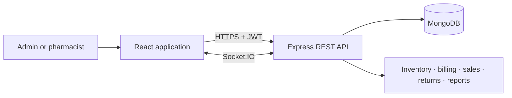

# Dhaka Pharmacy

**A full-stack pharmacy inventory, billing, and operations dashboard.**

Dhaka Pharmacy helps pharmacy staff manage medicine batches, stock levels,
point-of-sale billing, sales and returns, imports, and business reporting. The
application has role-based workflows for administrators and pharmacists, a
responsive React interface, and a MongoDB-backed Express API.

**Live demo:** [dhaka-pharmacy.vercel.app](https://dhaka-pharmacy.vercel.app/) · **API health:** [Render health endpoint](https://dhaka-pharmacy.onrender.com/api/health)

> This is a portfolio/demo application. Use only its isolated demo environment;
> do not enter real patient, customer, staff, or pharmacy business data.

## Screenshots

Screenshots are being prepared. Please see
[`docs/SCREENSHOTS.md`](docs/SCREENSHOTS.md) for the requested views and
privacy requirements. Images will be added here after review.

## What it does

- **Dashboard:** inventory and sales KPIs, stock-health visualization, recent
  transactions, and operational alerts.
- **Medicine catalog and inventory:** batch-level stock, expiry and low-stock
  monitoring, and medicine management.
- **Billing and sales:** point-of-sale workflow, sales history, and returns.
- **Reports and analytics:** date-range analysis, revenue/profit/refund trends,
  product comparisons, and spreadsheet exports.
- **Operations:** spreadsheet imports, special-drug records, user management,
  notification preferences, and audit history.
- **Role-based access:** administrator features are separated from pharmacist
  workflows.
- **Presentation details:** responsive layouts, light/dark themes, accessible
  chart interactions, and a client-only sample preview for the dashboard and
  analytics page.

The sample previews are generated in the browser and do not write to MongoDB.

## Technology

| Area | Technologies |
|---|---|
| Frontend | React 18, React Router, Axios, date-fns, Font Awesome |
| API | Node.js 18+, Express 4 |
| Data | MongoDB with Mongoose |
| Authentication | bcrypt password hashing, JWT |
| Real-time updates | Socket.IO |
| Deployment | Vercel (frontend), Render (API), MongoDB Atlas (database) |



More detail is in [`docs/ARCHITECTURE.md`](docs/ARCHITECTURE.md).

## Run locally

Requirements: Node.js 18 or newer, npm, and a MongoDB database reserved for
development/demo use.

1. Create local environment files from the examples:

   ```sh
   cp backend/.env.example backend/.env
   cp frontend/.env.example frontend/.env
   ```

2. Set `MONGODB_URI`, a unique random `JWT_SECRET`, and `SEED_ADMIN_PASSWORD`
   in `backend/.env`. The seed password is required only if you choose to run
   the destructive starter-data seed. Use an isolated, disposable database.
3. Install and start the API in one terminal:

   ```sh
   cd backend
   npm ci
   npm run dev
   ```

4. Install and start the frontend in a second terminal:

   ```sh
   cd frontend
   npm ci
   npm start
   ```

The frontend runs at `http://localhost:3000`; the API defaults to
`http://localhost:5001`. The frontend environment example points both REST and
Socket.IO traffic to that local API.

### Demo accounts and sample data

The login screen offers public demo profiles. Their credentials are deliberately
visible to visitors and **must be treated as public**, not as secrets. Seed
these accounts only in an isolated demo database:

```sh
cd backend
DEMO_MODE=true npm run seed:demo-users
```

This command refuses to overwrite accounts with the same demo usernames. The
starter-data command (`npm run seed`) deletes existing users and medicines
before recreating sample records. Only use it with a fresh disposable database;
configure `SEED_ADMIN_PASSWORD` first. Do not run it against production or any
database with data you need to keep.

## Validation

Build the frontend with:

```sh
npm --prefix frontend run build
```

The root `test-*.js` scripts exercise sales/returns flows and can create or
modify records. They require explicit test credentials and
`ALLOW_MUTATING_TESTS=true`; run them only against a disposable test database.

## Deployment

The repository includes a Render Blueprint in [`render.yaml`](render.yaml) and
a Vercel SPA rewrite in [`frontend/vercel.json`](frontend/vercel.json). Configure
production environment variables in the hosting providers, not in committed
files. `REACT_APP_*` frontend values are embedded at build time.

## Security notes

- Never commit `.env` files, database URIs, signing keys, access tokens, or real
  user data. The local environment files are ignored by Git; use the
  `.env.example` files as templates only.
- Public demo credentials are intentionally exposed for recruiter access. Keep
  the backing database disposable and isolated, and reset it regularly.
- The repository scan found no actual database connection string, private-key
  block, or open GitHub secret-scanning alert. It did find a weak fixed admin
  password in older public Git history; current seed and integration-test code
  no longer rely on that default. Rotate any account that may still use an old
  seeded password. Removing a value from the current files does not remove it
  from Git history.

## Project documentation

- [Architecture and data flows](docs/ARCHITECTURE.md)
- [Screenshot checklist](docs/SCREENSHOTS.md)
