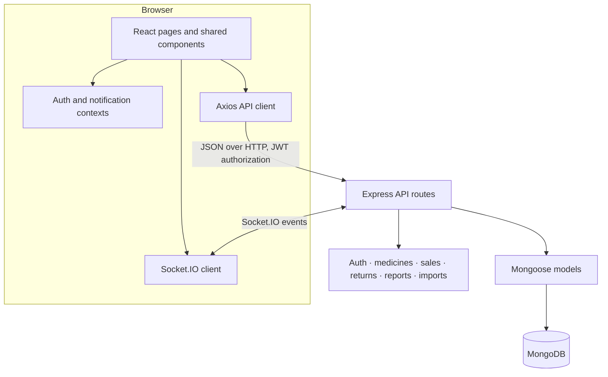

# Architecture

## System overview

Dhaka Pharmacy is a single-page React client backed by an Express API and
MongoDB. The frontend calls REST endpoints through Axios, attaches the signed-in
user's JWT to API requests, and uses Socket.IO for real-time notifications.
Routes and navigation are role-aware; administrators have additional reporting,
settings, and user-management surfaces.

## Repository map

| Path | Responsibility |
|---|---|
| `frontend/src/pages/` | Login, dashboard, catalog, inventory, billing, sales, returns, reports, imports, special drugs, settings, and user management |
| `frontend/src/context/` | Authentication and notification state |
| `frontend/src/utils/api.js` | Axios base URL, JWT request header, and unauthorized-session handling |
| `frontend/src/index.css` | Shared components, responsive layouts, themes, and page-specific styling |
| `backend/server.js` | Express setup, security middleware, CORS, route mounting, Socket.IO, and health check |
| `backend/routes/` | API endpoints grouped by application domain |
| `backend/models/` | Mongoose schemas for users, medicines, sales, returns, imports, special drugs, and audit history |
| `backend/middleware/` | Authentication/authorization and audit behavior |
| `backend/config/` | Database and Socket.IO configuration plus demo seeding |
| `backend/scripts/` | Guarded demo-user setup and sales-financial audit/repair utilities |

## Main request flows

### Sign-in and authorization

1. A user signs in from the React login page.
2. The API verifies the password hash and returns an authentication token.
3. The client keeps the token in session storage and attaches it to API requests.
4. Protected backend routes verify the token; role checks restrict administrative
   operations.

### Inventory and billing

Medicine records are batch-oriented and include stock and expiry information.
Billing uses the API to create sales, while sale and return routes preserve the
financial and item details needed by history and reporting views.

### Dashboard and reports

The dashboard combines inventory summaries, current-day sales, and recent
transactions with stock-health and seven-day sales charts. Reports support
date-range analysis, revenue/profit/refund trends, medicine comparisons, and
spreadsheet exports. Their sample previews are generated client-side and do not
persist or submit synthetic records.

### Real-time updates

Socket.IO is configured alongside Express to deliver live application
notifications. The browser also refreshes selected views when application data
changes during a session.

## Runtime configuration

Copy the example files to local `.env` files and supply environment-specific
values. Never put real values in the examples or commit local environment files.

| Variable | Used by | Purpose |
|---|---|---|
| `MONGODB_URI` | API | MongoDB connection string |
| `JWT_SECRET` | API | Signs and verifies authentication tokens |
| `JWT_EXPIRES_IN` | API | Token lifetime |
| `PORT` | API | HTTP server port |
| `FRONTEND_URL` | API | Configured frontend origin for deployment |
| `SEED_ADMIN_PASSWORD` | API seeder | Required password when running destructive starter-data seed |
| `REACT_APP_API_URL` | Frontend | REST API base URL |
| `REACT_APP_SOCKET_URL` | Frontend | Socket.IO server origin |

The frontend's `REACT_APP_*` values are compiled into its build. They must never
contain secrets.

## Deployment shape

- **Frontend:** Vercel, with `frontend/` as the project root and SPA fallback
  configured in `frontend/vercel.json`.
- **API:** Render using `render.yaml`; the blueprint expects database and
  frontend-origin values to be supplied in the service dashboard.
- **Database:** MongoDB Atlas with a dedicated database/user for the demo.

The public demo must use disposable, non-production data because demo accounts
are intentionally available to visitors.
